# BEHEMOTH

A wavetable bass synthesizer that runs in the browser. One HTML file, no dependencies, built for touch screens (phones and tablets). Works with a computer keyboard and MIDI too, and installs as an app that runs offline. Sibling of the ELEPHANT sampler groovebox.

**Try it:** open the GitHub Pages link of this repo on your phone and tap the screen to start audio. On an iPhone or iPad use *Share → Add to Home Screen* for a full-screen app.

## Screenshots

Phone upright: SOUND, MOD, FX and PLAY tabs, the wavetable editor, the preset browser, and the keys window expanded into a split keyboard or a multi-touch pad.

<p>
  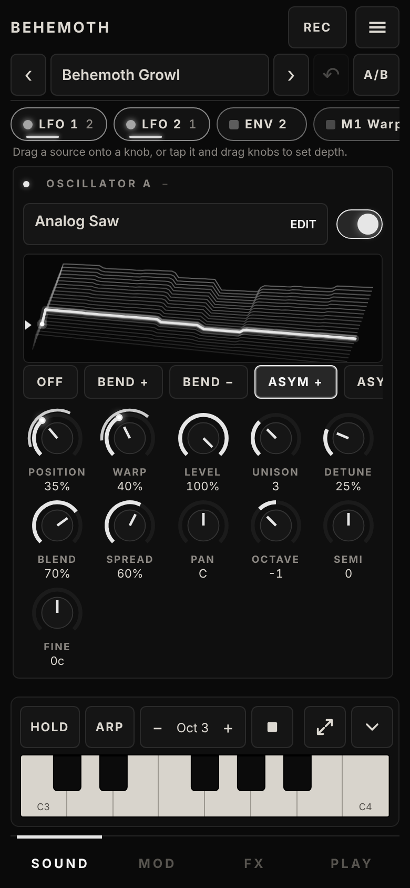
  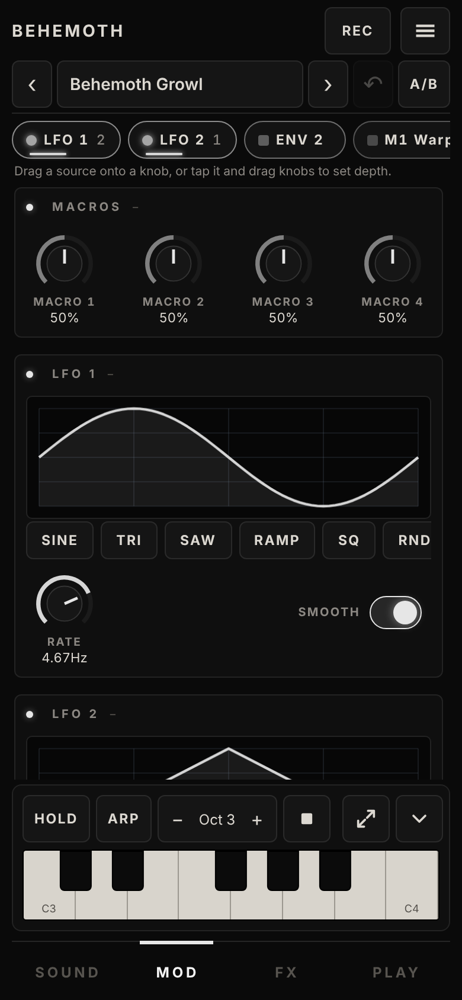
  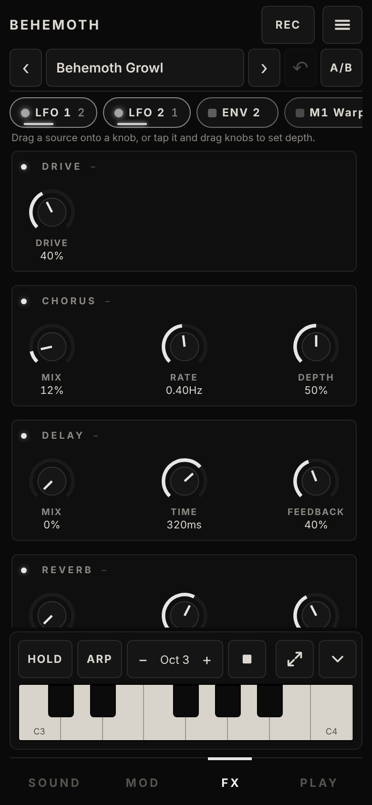
  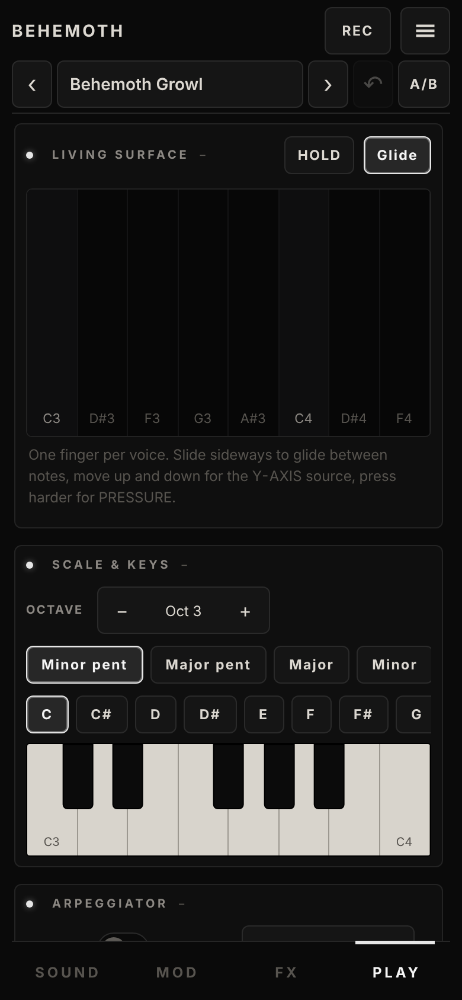
</p>
<p>
  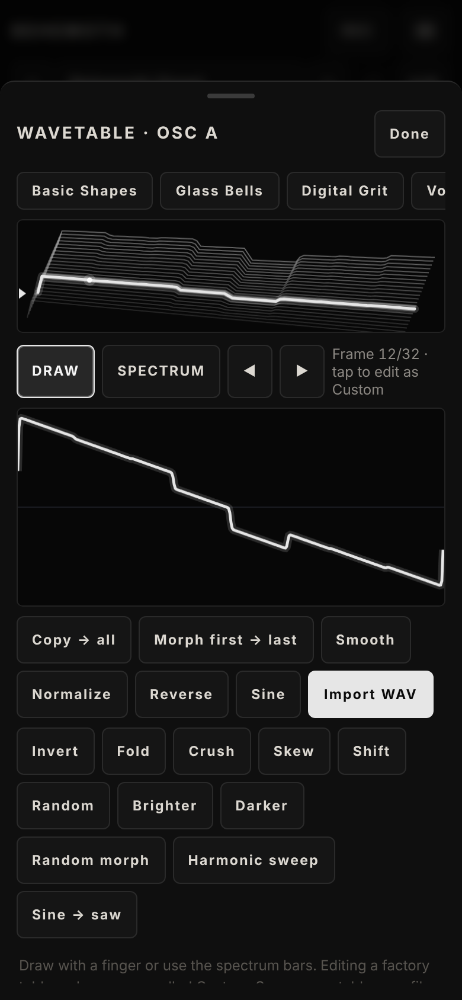
  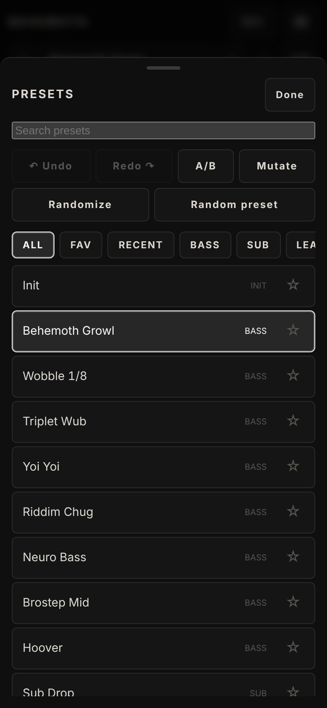
  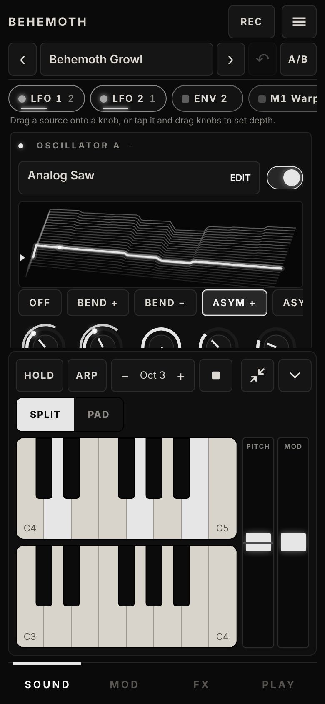
  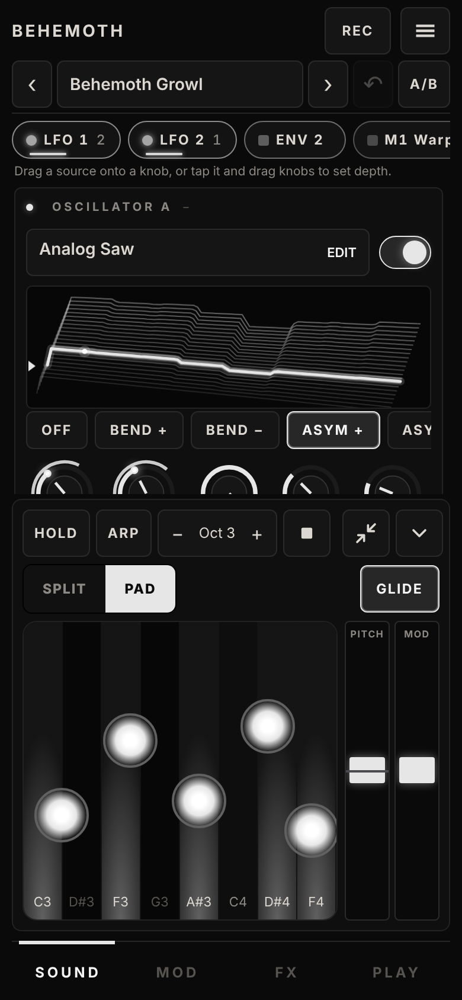
</p>

Phone held sideways and a tablet: the tabs move to a side rail, and Stage turns the whole screen into an instrument.

<p>
  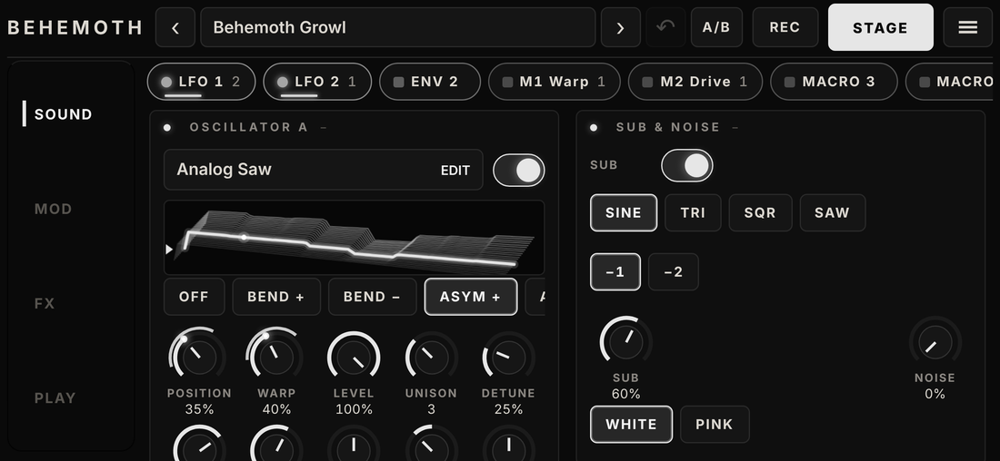
  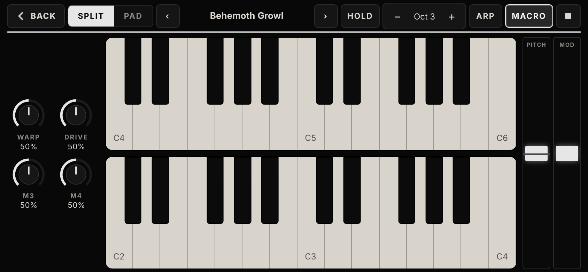
</p>
<p>
  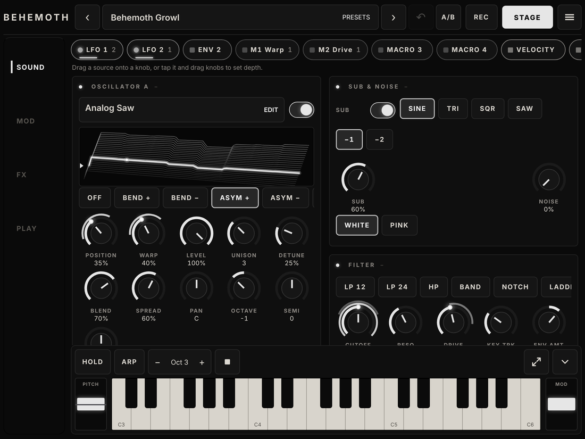
</p>

## Playing

- **Portrait:** the keyboard sits at the bottom of every tab. The arrows button expands it in place into a window with a **split keyboard** (two rows, one continuing the other) or a **multi-touch pad**, with pitch and mod wheels on your playing hand's side. All knobs above stay reachable, the window never closes by itself and HOLD stays on while you turn them. The chevron hides the keys completely.
- **Landscape:** the same button opens **Stage**, a full-screen version: a slim control bar, four macro knobs in a column beside the keys, two finger-sized rows that fill the height, and the wheels on your playing hand's side. MACRO hides the knob column when you need the room.
- **Keys, pad, arpeggiator, chords, sequencer** are on the PLAY tab; MIDI and a computer keyboard work everywhere.
- Left-handed mode mirrors the wheels and the macro column (menu → Hand).

## Features

**Sound**
- Two wavetable oscillators with a 3D table view, 9 warp modes (bend, asym, sync, mirror, quantize, FM, RM), unison, sub and noise
- 8 filter types: LP 12/24, HP, band, notch, ladder, comb, formant
- Modulation matrix with 32 destinations (pan, octave, fine tune, blend, spread, LFO rates, FX mixes and more): 2 LFOs, envelope 2, 4 macros, velocity, key, pressure, tilt and Y-axis. Drag a source onto a ringed knob
- Macros are named after what they do in the current preset (for example "M1 Space")
- Delay, chorus, reverb and drive

**Playing**
- Expandable keys window (portrait) and full-screen Stage (landscape), finger-sized keys, pitch and mod wheels on one side
- Expressive pad: one finger per voice, slide to glide, move up and down for the Y-axis source, press harder for pressure
- Chord memory (octave, fifth, power, major, minor, sus4, maj7, min7)
- Arpeggiator with a 4–16 step rhythm pattern (rests, accents, per-step transpose), swing, chance, humanize and accent amount, up to 4 octaves
- 16-step bass sequencer: tap a step for rest / note / accent, drag it to set pitch; keys transpose the pattern
- Hold, glide, mono/poly (up to 8 voices); on mono presets extra fingers and chords still add voices, tilt as a modulation source

**Workflow**
- 57 factory presets, including aggressive, melancholic, metal and vintage sets
- Favourites, recent, search, random preset, Mutate and Randomize
- Undo / redo of every edit, and A/B compare with the saved preset
- Record the output and save or share it as a 16-bit stereo WAV
- MIDI: notes, pitch bend, sustain pedal (CC 64), channel and poly aftertouch, and MIDI learn for any knob (Settings → MIDI)
- User presets with JSON import/export, wavetable editor
- Collapsible modules, value readout above your finger while turning a knob, text size and contrast settings, step-by-step tutorial and contextual tips (switch them off or replay in the menu)
- Interface languages: English, Russian, German and Spanish (follows the browser language, or choose it in the menu → Language)

**Phones and tablets**
- Portrait, landscape and tablet layouts; wide screens flow the modules into 2–3 columns and keep the keyboard on screen
- Safe areas, dynamic viewport height and blurred overlays for notched phones
- Installable as an app (PWA): fullscreen, works offline once loaded

## Run

Open `index.html` in a modern browser and tap the screen to start audio.

For the best audio performance and to enable install and offline use, serve the files over HTTPS, for example with GitHub Pages. Some sandboxed previewers block the AudioWorklet, and the synth then falls back to a slower compatibility mode.

### GitHub Pages

Settings → Pages → Deploy from branch → `main` / root. The synth is then available at `https://<user>.github.io/<repo>/`. On an iPad or iPhone use Share → Add to Home Screen, on Android use the Install app button in Settings.

## Files

| File | Purpose |
| --- | --- |
| `index.html` | The whole synth: UI and DSP engine, built from `src/` (this is the file to open or deploy) |
| `src/` | Source: `engine.js` (DSP), `ui/*.js` (UI modules), `css/*.css`, `index.template.html` |
| `build.mjs` | Assembles `src/` into `index.html` (no dependencies) |
| `screenshots/` | README screenshots |
| `test/` | Engine smoke test |
| `icons/`, `manifest.webmanifest`, `sw.js` | Install and offline support (optional) |
| `.github/` | CI: checks that `index.html` is up to date and runs the engine test on every push |
| `LICENSE` | MIT |

## Development

Edit the files in `src/`, then rebuild the single file (Node 18 or newer, no packages to install):

```
node build.mjs         # writes index.html
node build.mjs --check # fails if index.html is out of date
node test/engine.test.mjs
```

`index.html` is committed so the synth works straight from GitHub Pages. The UI modules share one scope: they are concatenated in the order listed in `build.mjs`, so a new file has to be added to that list. After a change that users should receive, bump `VERSION` in `sw.js` so installed copies refresh.

## Browser support

Current Chrome, Edge, Safari and Firefox. Web MIDI is available in Chromium-based browsers, not in iOS Safari.

## License

[MIT](LICENSE). Copyright (c) 2026 Kirill Kinderhart.
